# Architecture

Design record for Rain Corrector. This document describes the system as
implemented; where it states an invariant, there is code enforcing it.

---

## 1. System overview

Rain Corrector answers three questions:

1. **What rainfall is expected?** A versioned model predicts 24 h accumulation
   per district, with a 10th–90th percentile interval.
2. **How good was that prediction?** Every issuance is stored. Once the target
   period has elapsed, it is scored against the observed aggregate, and the
   scores are stored with it.
3. **Is the current model the right one?** Verified scores are compared across
   model versions, and promotion is gated on that comparison.

The three questions are separate concerns with separate stores. Nothing in the
request path retrains, and nothing in the training path serves traffic.

### Design constraints

| Constraint | Consequence |
| --- | --- |
| Rainfall is intermittent and autocorrelated | Event scores matter alongside millimetre errors; splits must be chronological |
| Forecasts must be auditable after the fact | Every issuance is persisted, never overwritten |
| Model quality cannot be judged before observations exist | Verification is a separate, delayed stage |
| Serving must be cheap and predictable | Artifacts are loaded once and cached in-process |
| Open mapping must stay free | OpenStreetMap tiles via configuration, no proprietary SDK |

## 2. High-level architecture

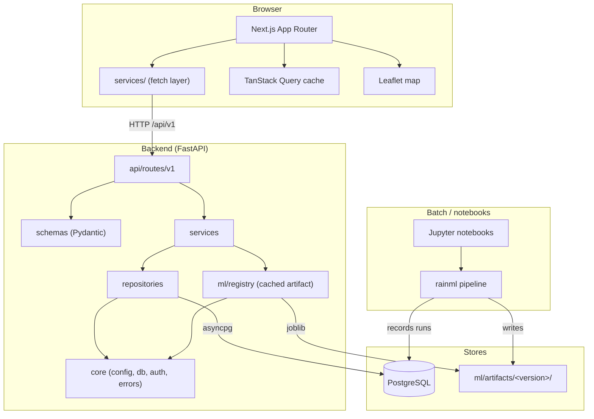

Three deployables, no shared runtime. The frontend bundle contains no ML code
and no database driver. The backend image contains no training code.

## 3. Frontend architecture

### Structure

```text
app/                     routes (App Router)
  layout.tsx             shell: sidebar, header, QueryProvider
  page.tsx               dashboard
  map/ forecasts/ verification/ alerts/ models/
components/              shared UI (DashboardCard, DataTable, states, layout)
features/<name>/
  components/            feature UI
  hooks/                 feature data hooks
  utils/                 feature pure logic
services/                the only place fetch() appears
lib/                     config, formatters, severity tokens, query keys
types/api.ts             types mirroring the API contract
```

### Data flow

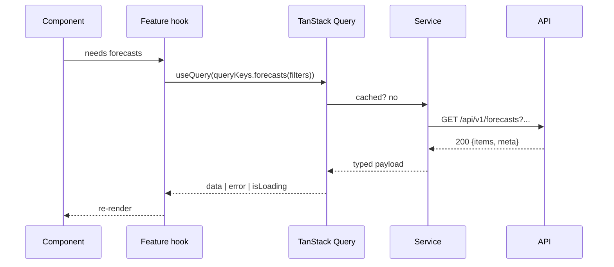

Rules the code enforces:

- `services/api-client.ts` is the single `fetch` call site. It normalises the
  error envelope into `ApiError`, applies a timeout, serialises array query
  parameters, and sets `X-API-Key` when supplied.
- `lib/query-keys.ts` centralises keys, so invalidation cannot miss one.
- Retry policy: 4xx never retried (it will not become valid), 5xx retried twice.
- No component calls a service directly. Components consume hooks.

### State ownership

| State | Owner | Why |
| --- | --- | --- |
| Server state | TanStack Query | Caching, deduplication, staleness, invalidation |
| Filters, selection | `useState` in the feature | Ephemeral, not shared |
| Form input | React Hook Form + Zod | Validation at the boundary |
| Map view state | `useState` in `MapView` | The map is a self-contained island |

### Leaflet and SSR

`leaflet` reads `window` at module evaluation, so it cannot run on the server.
`MapView` is therefore imported with `ssr: false` from a client component
(`MapPageClient`), because Next.js forbids `ssr: false` inside a server
component. The map is the only such island.

### Map architecture

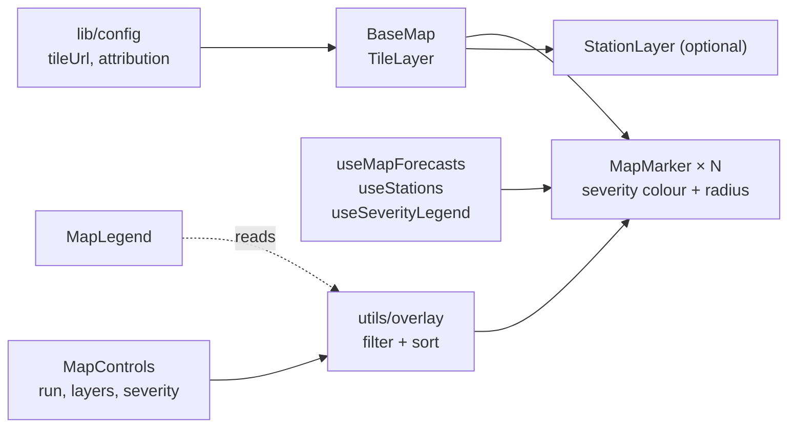

- Tiles come from `NEXT_PUBLIC_MAP_TILE_URL`, defaulting to OpenStreetMap. Any
  OSM-compatible provider can be substituted through configuration.
- The colour scale is read from `GET /forecasts/legend`, so the map, the legend
  and the alert rules cannot drift apart.
- Markers are sorted so the smallest (lightest) render last: Leaflet paints in
  insertion order, and a heavy-rain district next to a light one would otherwise
  swallow it.
- Severity toggles filter the overlay; the counts of hidden markers are reported
  so the user can tell a filter is active from an absence of data.

## 4. Backend architecture

### Layering

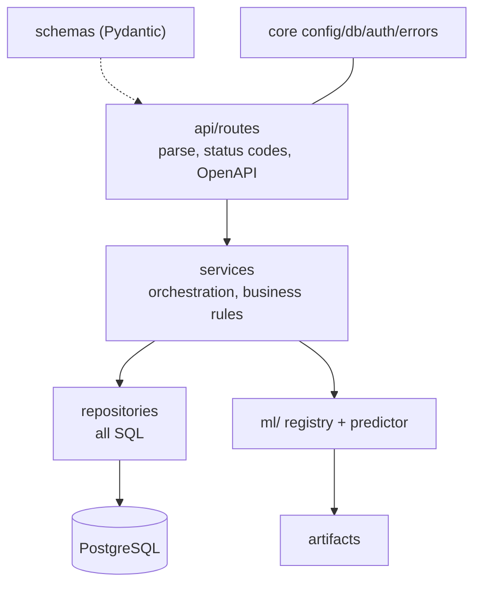

- Routes never write SQL and never call the model registry directly.
- Repositories own every query. Services never see an ORM column.
- ORM models are never returned from a route; Pydantic schemas are.
- `ml/` is invoked only through `ModelRegistry`, which owns caching.

### Request pipeline

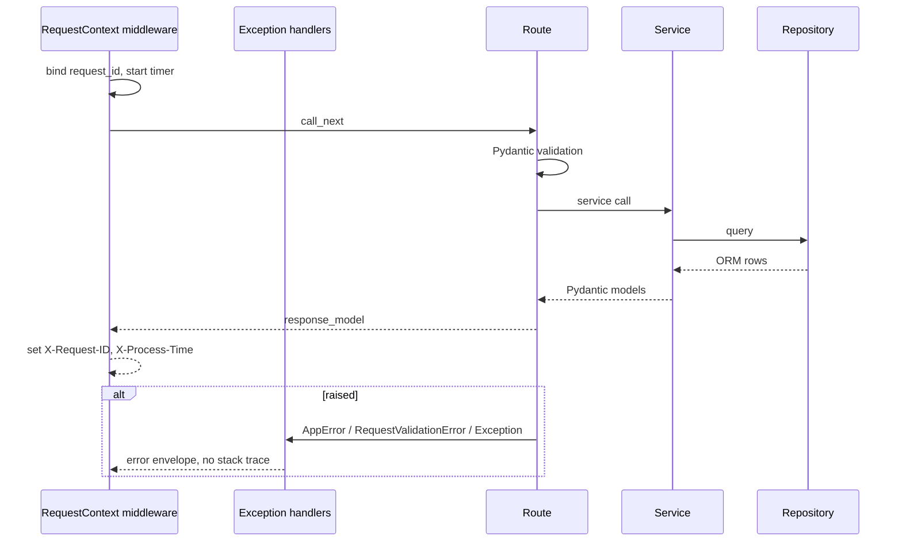

### Error handling

Every failure is a typed `AppError` subclass carrying an HTTP status, a stable
machine code and a human message:

| Class | Status | Code |
| --- | --- | --- |
| `NotFoundError` | 404 | `not_found` |
| `ValidationError` | 422 | `validation_error` |
| `ConflictError` | 409 | `conflict` |
| `AuthenticationError` | 401 | `unauthorized` |
| `ModelUnavailableError` | 503 | `model_unavailable` |
| `PredictionError` | 500 | `prediction_failed` |
| `ProviderError` | 502 | `provider_error` |

An unhandled exception is logged with its traceback and returned as a bare
`internal_error` plus the request id, so a user can quote a correlation id
without seeing internals.

## 5. ML architecture

### Package layout

```text
rainml/
  data/        loaders, cleaning, validation
  features/    engineering (with leakage guards), selection
  models/      baselines, candidates, artifact registry
  training/    configuration, trainer
  evaluation/  metrics, evaluator
  inference/   preprocessing, predictor
```

`rainml` does not import `app`. The backend depends on `rainml`, never the
reverse, so the library stays usable from a notebook or a batch job with no
backend on the path.

### Training pipeline

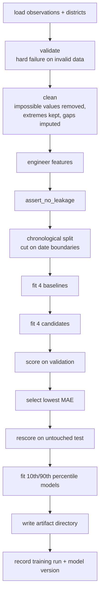

### Why these choices

**Chronological split on date boundaries.** Daily rainfall is strongly
autocorrelated. A random split places the day after a training day in the test
set, so a model that repeats yesterday's rainfall scores well without skill.
`ml/tests/test_data.py::test_persistence_skill_depends_on_the_split` measures
this directly on the demo dataset. The split cuts on dates, not row counts,
because every district shares an issue date and a row-count cut would slice
through one.

**Baselines are mandatory.** Persistence is strong for 24 h rainfall. A candidate
that cannot beat `persistence` is not worth serving. `beats_baseline` is recorded
in the run and is the evidence the promotion policy later uses.

**Quantile regressors for the interval.** Two independent `QuantileRegressor`
fits at 0.1 and 0.9 give a calibrated band. Because independent fits can cross on
small samples, `ModelArtifact.predict_interval` clamps the lower bound to the
point forecast and the upper bound to at least it, so the served interval is
always ordered.

**Robust scaling, not standardisation.** Rainfall features are right skewed and
heavy outliers are physically real, not defects, so `RobustScaler` (5th–95th
percentile) is preferred over `StandardScaler`.

**Huber loss for the selected candidate.** Limit the influence of extreme days
during fitting, while still fitting them.

### Feature leakage contract

| Feature | Reads | Guarantee |
| --- | --- | --- |
| `antecedent_rain_24h_mm` | `shift(1)` | never the issue day |
| `rain_last_Nd_mm` | `shift(1).rolling(N)` | never the issue day |
| `dry_streak_days` | `shift(1)` | counted backwards from the issue date |
| `recent_*_30d` | `shift(1).rolling(30)` | 30 days before issue |
| `doy_sin`, `doy_cos` | `target_date` | the target date is known at issue time, so this is not leakage, and using the target date is what keeps training and serving identical |
| `regional_mean_rain_7d_mm` | same-day cross-section of `rain_last_7d_mm` | batch mean, computed after the target drop so every issue date has the same district set |

Enforcement:

1. `assert_no_leakage` fails if the antecedent term mirrors the target.
2. `validate_split` re-checks the partitions for temporal overlap.
3. `ml/tests/test_features.py` asserts serving features equal training features
   for the same day. This caught two real mismatches during development: a
   seasonal term computed from the issue date instead of the target date, and a
   standard deviation computed with `ddof=0` against pandas' `ddof=1`.

## 6. Data pipeline

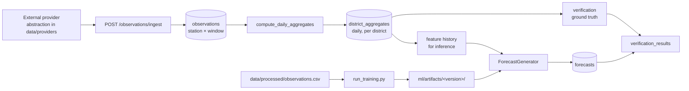

`district_aggregates` is a derived fact table, not a view. Materialising it
means verification and inference never re-aggregate raw station rows, and the
aggregation window is explicit rather than implied by a query.

**Provenance.** Every measurement row carries `origin` (`observed`,
`synthetic`, `external`) and `source`. Real telemetry data from the Central
Water Commission (CWC) and CPCB is flagged as `observed` with source `cwc_telemetry`;
synthetic data is preserved exclusively for unit tests and local mock fixtures.
Full dataset details are documented in `DATASETS.md`.

**External data providers** are abstracted behind an interface so no route
imports a vendor SDK. `DATA_PROVIDER` selects the implementation and
`ENABLE_EXTERNAL_INGESTION` gates it, so a deployment that must not reach the
public internet simply keeps the flag false.

### Bulk writes

asyncpg caps a statement at 32767 bind parameters. Both the observation insert
and the aggregate upsert chunk their batches. This is a driver limit, not a
stylistic choice; see `ObservationRepository.bulk_insert`.

## 7. Database architecture

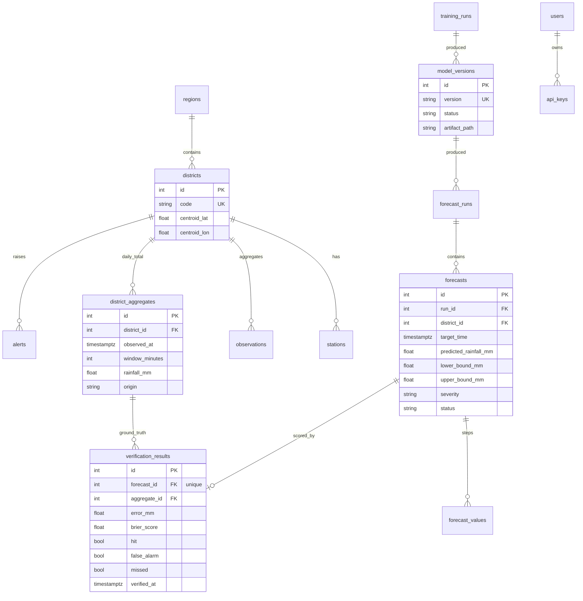

### Modelling decisions

**`verification_results.forecast_id` is unique.** One forecast, one score. A
re-score updates the row (`force=true`) rather than appending a second
judgment.

**`forecasts` has a unique `(run_id, district_id)`.** A run is one issuance over
a district set; the database enforces that invariant.

**`severity` is stored, not derived at read time.** Severity bands are
configuration, and a change to them must not silently reinterpret history. The
stored value is what the forecast meant when it was issued.

**`model_versions.status` rather than a boolean `is_active`.** Promotion is a
lifecycle with four states, and a boolean cannot express `candidate` versus
`validated`. A partial unique index is not needed: `ModelRepository.set_status`
archives the incumbent in the same transaction that activates the successor.

### Indexes

Indexes follow the filters the API actually applies:

| Table | Index | Query it serves |
| --- | --- | --- |
| `forecasts` | `(district_id, target_time, status)` | map and district queries |
| `forecasts` | `target_time` | time-window queries |
| `forecasts` | `severity` | severity filtering |
| `observations` | `(station_id, observed_at)` | station history |
| `district_aggregates` | `(district_id, observed_at)` | feature history and verification |
| `verification_results` | `(status, observed_at)` | pending sweep |
| `model_versions` | `version` unique, `status` | registry lookups |
| `alerts` | `(status, severity, valid_from)` | dashboard alert list |

### Spatial data

District centroids plus optional `geometry_geojson` are stored as plain columns.
Bounding-box queries translate to a four-clause range predicate, which is
appropriate at this scale (hundreds of districts) and needs no PostGIS extension.

**When to move to PostGIS:** once queries need true containment
(point-in-polygon, corridor selection, distance to a river), or once the district
count grows by orders of magnitude. The migration path is to add the extension,
move `geometry_geojson` to a `geometry(Polygon, 4326)` column with a GiST index,
and replace `BoundingBox.apply` with `ST_Intersects`. Nothing above the
repository layer depends on which is in use.

## 8. API architecture

Versioned under `/api/v1`. Full reference in [`docs/api/README.md`](docs/api/README.md).

### Conventions

- Collections: `GET` with `page` (≥1) and `page_size` (1–200), returning
  `{"items": [...], "meta": {page, page_size, total, total_pages, has_next, has_previous}}`.
- Filters are query parameters with explicit bounds; out-of-range values produce
  a 422 listing the field.
- Mutations declare their status code: `201` for creation, `200` for state
  changes.
- Every operation has a `summary` and a `description`; a test asserts none is
  missing.
- Errors: `{"error": {"code", "message", "details"}, "request_id", "timestamp"}`.

### Endpoints

| Method | Path | Purpose |
| --- | --- | --- |
| GET | `/health` | Liveness |
| GET | `/health/ready` | Readiness, including database and model state |
| GET | `/locations/regions` | List regions |
| GET | `/locations/districts` | Paginated, filterable by region, name, bbox |
| GET | `/locations/districts/{id}` | Detail with region and station count |
| GET | `/locations/stations` | Stations, optionally per district |
| POST | `/locations/stations` | Register a station |
| POST | `/observations/ingest` | Batch ingestion, idempotent |
| GET | `/observations/district/{id}` | Station observations in a window |
| GET | `/observations/aggregates` | Daily district aggregates |
| GET | `/forecasts` | Filtered, paginated |
| GET | `/forecasts/map` | Latest run for map rendering |
| GET | `/forecasts/legend` | Severity bands for the legend |
| GET | `/forecasts/runs` | Issuance history |
| GET | `/forecasts/runs/{uid}` | Run detail |
| GET | `/forecasts/{id}` | Detail with per-lead-time values |
| POST | `/forecasts/generate` | Issue and persist a run, derive alerts |
| GET | `/verification/results` | Scored forecasts, filterable |
| GET | `/verification/metrics` | Aggregated skill |
| GET | `/verification/forecast/{id}` | Score for one forecast |
| GET | `/verification/batches` | Verification job history |
| POST | `/verification/run` | Score matured forecasts |
| GET | `/models/versions` | Registry |
| GET | `/models/versions/{version}` | Model card |
| GET | `/models/active` | Currently served version |
| GET | `/models/training-runs` | Training history |
| GET | `/models/policies` | Supported promotion policies |
| POST | `/models/promote` | Activate a version under a policy |
| POST | `/models/reload` | Reload the serving process |
| GET | `/alerts` | Filtered, paginated |
| GET | `/alerts/summary` | Open counts by severity |
| GET | `/alerts/{id}` | Alert detail |
| PATCH | `/alerts/{id}` | Acknowledge or resolve |
| GET | `/dashboard/overview` | Aggregated dashboard payload |

### The dashboard endpoint

`/dashboard/overview` exists because the dashboard needs counters from five
tables at once. Without it the frontend would issue six requests and correlate
them client-side, and every number on screen could come from a different
instant. One aggregate query set, one consistent snapshot, one `generated_at`.

## 9. Model inference flow

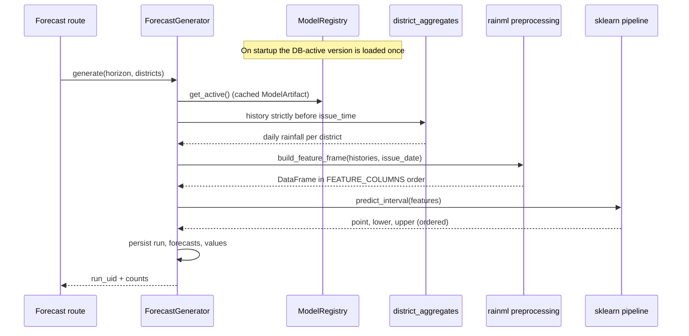

### Caching

`ModelRegistry` holds one `ModelArtifact` behind a lock. The lifespan hook loads
the database-active version at startup; `reload_if_needed` swaps only when the
requested version differs, so a normal request pays no deserialisation cost.

`predict_interval` validates that the frame contains every feature the persisted
preprocessor expects and fails loudly if not. A partial frame would otherwise
produce a plausible-looking wrong answer.

### Why the feature frame is built by `rainml`

`backend/app/ml/features.py` is a thin adapter over
`rainml.inference.preprocessing`. Rolling-window arithmetic exists once. Two
copies drift, and the drift only appears in production — which is why the
parity test in `ml/tests/test_features.py` compares the two paths directly.

## 10. Forecast verification flow

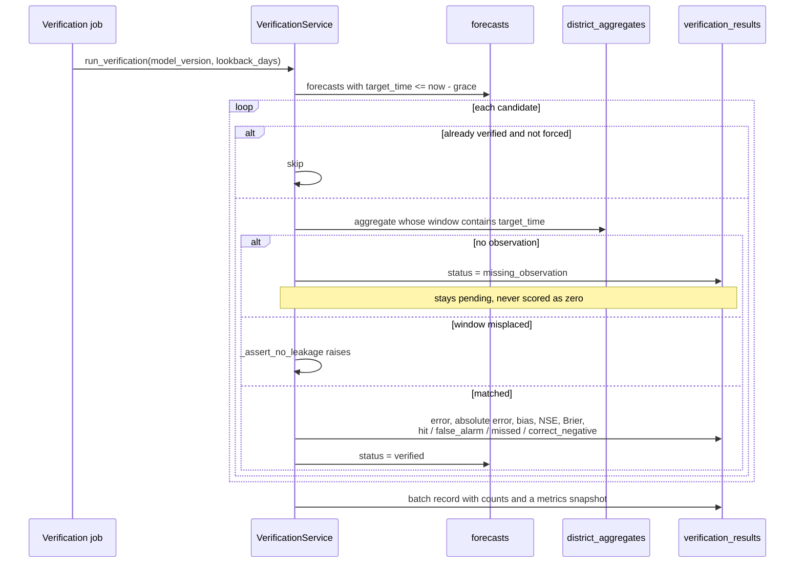

### The grace period

`VERIFICATION_GRACE_PERIOD_HOURS` defaults to 6. A forecast is eligible only when
`target_time` is older than `now - grace`. Without it, a forecast issued for a
day that just ended would be scored against an accumulation window that may
still be open at a gauge.

### Leakage checks at scoring time

`_assert_no_leakage` raises if the aggregate starts after the forecast target or
ends more than an hour before it. The second condition matters: an aggregate for
the wrong day would produce a plausible-looking score for the wrong period.

### Metric definitions

| Metric | Definition |
| --- | --- |
| MAE | `mean(observed - forecast)` |
| RMSE | `sqrt(mean((observed - forecast)^2))` |
| Bias | `mean(forecast - observed)`; positive means over-forecasting |
| NSE | `1 - SS_res / SS_tot` against the observed mean; `None` when the observations have no variance |
| POD | `hits / (hits + misses)`; `None` when no events occurred |
| FAR | `false_alarms / (hits + false_alarms)`; `None` when nothing was forecast |
| CSI | `hits / total` |
| Brier | mean squared error of `clip(forecast/15, 0, 1)` against the event indicator |

An undefined ratio returns `None`, not `0.0`. Reporting zero for a metric with an
empty denominator is a claim about skill the sample cannot support.

## 11. Model retraining flow

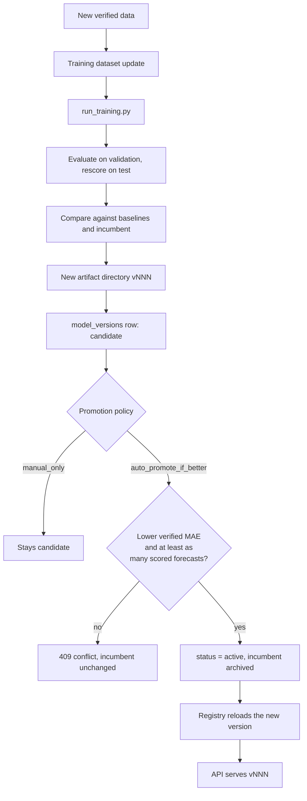

### Promotion policy

The policy is configurable (`DEFAULT_PROMOTION_POLICY`, or `policy` in the
promotion request):

| Policy | Behaviour |
| --- | --- |
| `auto_promote_if_better` | Default. Requires strictly lower verified MAE **and** at least as many scored forecasts as the incumbent. Otherwise `409`. |
| `manual_only` | Never activates automatically; the endpoint records the request path but leaves `status` unchanged, for review gates. |
| `force` | Activates unconditionally, including an archived or rejected version. Intended for rollback. |

Two properties hold under every policy:

- **Training never promotes.** A run registers a `candidate` and stops.
- **Promotion never leaves two active versions.** Activating one archives the
  incumbent in the same transaction.

`_is_better` compares MAE because that is the metric model selection uses;
comparing on a different metric at promotion time would make the decision
irreproducible. The sample-size guard stops a candidate with three verified
forecasts from displacing one with three thousand.

### Scheduling

`scripts/run_jobs.sh` is the job entry point. `forecast` issues a run and then
verifies whatever has matured; `retrain` trains and registers a candidate.
Promotion stays a deliberate, separate act. `RETRAINING_MIN_INTERVAL_HOURS`
exists so a scheduler does not retrain on every tick.

## 12. Map architecture

Covered in detail in section 3. The architectural points:

- Only OpenStreetMap-compatible raster tiles. No proprietary SDK, no key in the
  bundle, no key on the server.
- The tile provider is configuration (`NEXT_PUBLIC_MAP_TILE_URL`,
  `NEXT_PUBLIC_MAP_ATTRIBUTION`), so switching providers is an env change.
- The colour scale is served by the API rather than duplicated in the client,
  so the map, the legend, the tables and the alert thresholds agree.
- Attribution is displayed and configurable, because the OSM tile usage policy
  requires visible attribution.
- The map is isolated behind `features/map/`, so replacing Leaflet touches one
  directory.

## 13. Authentication and authorisation

Optional, off by default (`ENABLE_API_KEY_AUTH=false`) so a first run needs no
setup. When enabled:

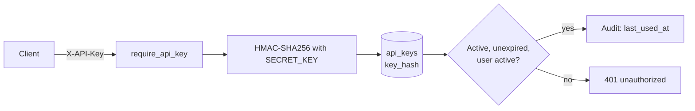

- Keys are stored as keyed digests. A database leak does not yield usable keys.
- `SECRET_KEY` is the HMAC pepper and must be changed for any deployment.
- `require_api_key` guards writes (forecast generation, promotion, alert status)
  and identity. Health and documentation stay public so orchestration works.
- The hash is deterministic, which is what makes verification possible at all; a
  random per-key salt would require a lookup per key.
- Authorization is a single tier: any valid key may write. Row-level roles are
  out of scope for a single-operator deployment, and adding them means adding a
  role column, not restructuring auth.

## 14. Error-handling strategy

| Layer | Policy |
| --- | --- |
| Repository | Let database errors propagate; translate at the service boundary |
| Service | Catch the specific error, raise a typed `AppError` with a useful message, log with context |
| Route | Declare the response model; let the handler produce the envelope |
| App | One handler per exception type; unexpected errors are logged with a traceback and returned as `internal_error` plus a request id |

Principles:

- A user never sees a stack trace or an ORM message.
- Every error carries a stable `code` for programmatic handling and a `message`
  for a person.
- Validation errors name the field.
- Expected failures are modelled as exceptions, not return codes.

## 15. Logging strategy

`structlog`, configured once in `app/core/logging_config.py`. Text for
development, JSON for production (`LOG_FORMAT`).

What is logged:

| Event | Level | Fields |
| --- | --- | --- |
| Startup / shutdown | info | environment, api_version, artifact path |
| Model loaded | info | version, features, artifact_dir |
| Model warm-up failed | error | error, available versions |
| Forecast run generated | info | run_uid, version, issued_at, districts |
| Forecast generation failed | error | version, error, traceback |
| Observations ingested | info | accepted, duplicates, aggregates_updated |
| Ingestion failed | error | error, traceback |
| Verification batch completed | info | batch_uid, considered, verified, pending |
| Training run registered | info | run_id, status, version |
| Alert created | info | count |
| API error | warning | code, status, message |
| Unhandled exception | error | error, traceback, request_id |

What is never logged: passwords, API keys, tokens, raw request bodies containing
credentials, personal data. `logging_config._drop_sensitive` redacts by key name
as a backstop, so a future `logger.info(**config)` cannot leak a secret.

Every log line within a request carries `request_id` from
`structlog.contextvars`, bound by middleware.

## 16. Configuration strategy

One source of truth: `app/core/config.py`, a `pydantic-settings` class reading
the repository root `.env`.

- Every setting has a type and a validator; a malformed URL fails at startup
  rather than at the first request.
- Path settings resolve relative paths against the repository root, so the
  artifact path is the same from a notebook, a script and a container.
- `settings` is cached with `lru_cache`, so validation runs once.
- The frontend reads only `NEXT_PUBLIC_*`, which Next.js inlines at build time.
  Nothing secret may use that prefix.
- `.env.example` documents every variable; `.env` is git-ignored.

Defaults are chosen so a clean checkout runs, with one exception: `SECRET_KEY`
has an intentionally invalid default, and `ENABLE_API_KEY_AUTH` defaults to
false so the insecure pepper is not load-bearing in development.

## 17. Deployment architecture

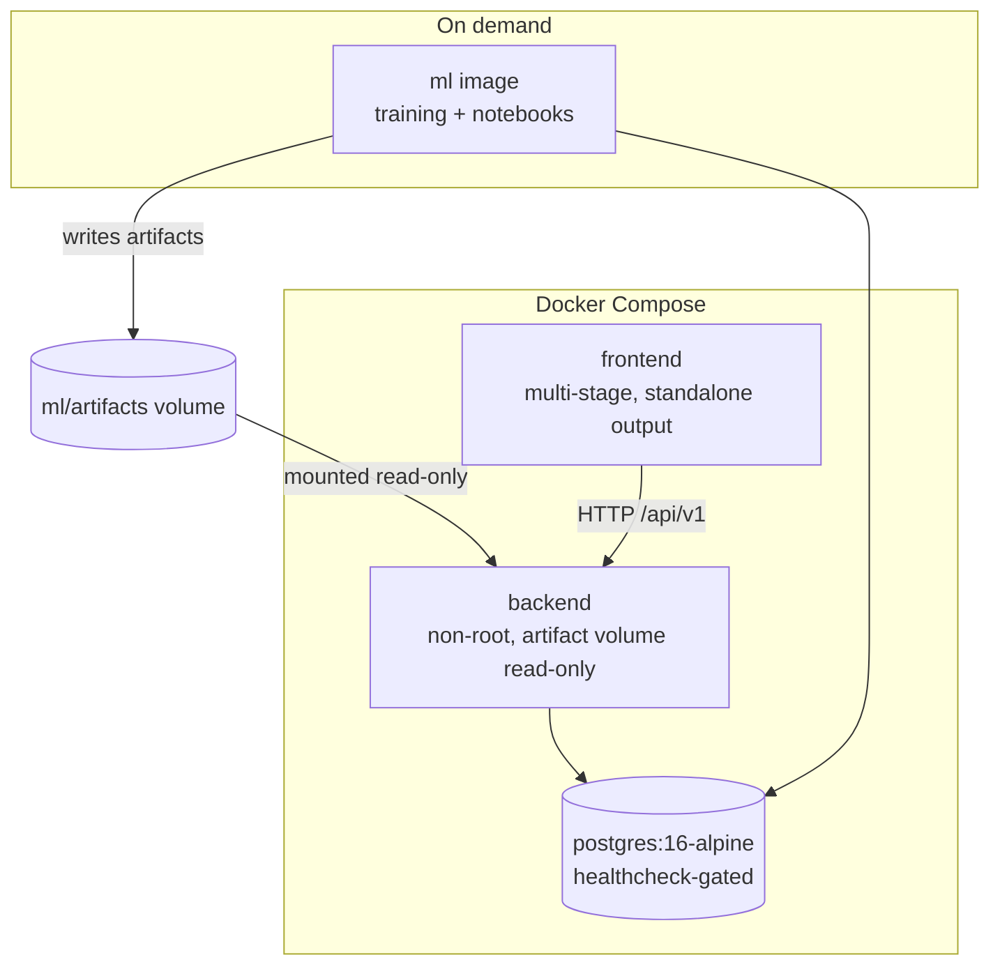

- `db` has a healthcheck; `backend` waits for it, so the API never starts
  against a database that is still initialising.
- The backend image contains no training code. The ML image contains no
  serving code.
- Artifacts are shared through a volume, read-only into the API. A model trained
  on the host is served unchanged.
- Both service images run as non-root.
- `/health` and `/health/ready` back the container healthchecks. Readiness
  reports `degraded` when the database is unreachable or no model is loaded, and
  returns 503 so orchestration restarts it.

Scaling notes, in the order they would bite:

1. **Forecast generation is O(districts).** Hundreds of districts is a single
   batched `predict`; tens of thousands would need chunking.
2. **Verification is O(matured forecasts)** and issues per-forecast queries. At
   a few thousand per run it is fine; beyond that, batch the aggregate lookup
   and score in memory.
3. **The dashboard aggregate is the heaviest read.** It is already one payload;
   beyond a few thousand forecasts, precompute per-district daily rollups.
4. **The in-process model cache is per replica.** Promotion must be followed by
   a restart or a `POST /models/reload` on each replica, or set `MODEL_VERSION`
   so replicas converge on restart. This is the one place the architecture does
   not scale out automatically, and it is deliberate: correctness beats
   per-request cache invalidation.

## 18. Technology decisions and rationale

| Decision | Alternative rejected | Why |
| --- | --- | --- |
| scikit-learn | XGBoost, PyTorch | The problem is tabular regression on a few hundred districts. A boosted-tree model is the right tool, and scikit-learn keeps the pipeline serialisable and the dependency surface small |
| Gradient boosting with Huber loss | Plain squared error | Squared error chases extreme days; a heavy day is real signal, not noise to fit exactly |
| Quantile regression for intervals | Bootstrap, conformal | Two extra fits, no resampling, and the band is calibrated on the training distribution |
| Chronological split | Random split, walk-forward | Random leaks through autocorrelation; walk-forward is better but needs a longer record than the demo dataset provides. The single chronological split is honest about what it assumes |
| Materialised `district_aggregates` | Compute on read | Verification would re-aggregate raw stations on every sweep, and the window would be implicit |
| async SQLAlchemy | Sync | Verification and ingestion are IO-bound; async keeps one connection pool under concurrent dashboard reads |
| Next.js App Router | Pages Router | Server components keep data fetching out of the client bundle |
| TanStack Query | Redux, SWR | Server-state cache with invalidation primitives; no manual store to keep in sync |
| Leaflet | MapLibre GL, deck.gl | Small, no WebGL requirement, works on low-end mobile. Adequate for a few hundred markers |
| OpenStreetMap raster tiles | Google Maps, Mapbox | Free, no key, no vendor lock-in. GL rendering would be justified at thousands of features, not hundreds |
| API key auth only | JWT + refresh | The API is machine-to-machine for a single operator; a token lifecycle would add state without adding capability |
| Versioned artifacts on disk | Model in the database | Pickles in a database are not independently verifiable; a directory with a checksum is |

## 19. Security considerations

| Concern | Mitigation |
| --- | --- |
| SQL injection | SQLAlchemy parameter binding throughout. No string-built SQL anywhere, including bounding-box filters |
| Secrets in source | Settings only. `.env` git-ignored. `SECRET_KEY` must be changed for deployment |
| API key theft from the database | Keys stored as HMAC-SHA256 digests, never plaintext |
| Secrets in logs | Redaction by key name as a backstop |
| CORS | Explicit allow-list from `CORS_ORIGINS`; no wildcard |
| Stack trace leakage | Unhandled exceptions return a bare code plus a request id; the traceback stays in the log |
| Mass assignment | Pydantic schemas on every request; the ORM is never bound directly to user input |
| Future-dated observations | Rejected by schema validator |
| Non-commercial map provider | OpenStreetMap only; no key exists to leak |
| Unsafe deserialisation | Artifacts are joblib files from our own training run, checksum-verified at load. The checksum is a corruption guard, not a defence against a hostile artifact; artifacts must come from a trusted build |
| Unbounded ingestion | Batch cap of 5000 observations, page size cap of 200, date lookback caps on verification |
| Container privileges | Both service images run as non-root |

Accepted risks, stated plainly:

- `ENABLE_API_KEY_AUTH=false` is the default, so a fresh deployment is open.
  That is a deliberate usability choice for local development; production must
  set it true and change `SECRET_KEY`.
- The default OSM tile endpoint is not appropriate for production traffic.
  Point `NEXT_PUBLIC_MAP_TILE_URL` at a provider whose policy permits the load.

## 20. Extension points

Each of these is a defined seam, not a rewrite.

| To add | Where | What changes |
| --- | --- | --- |
| A new data provider | `backend/app/data/providers/` | Implement the base interface; select it with `DATA_PROVIDER` |
| A new model family | `ml/src/rainml/models/forecasting.py` | Add a `CandidateSpec`; the trainer picks it up from config |
| A new baseline | `ml/src/rainml/models/baseline.py` | Add to `baseline_estimators()`; the comparison gate includes it |
| A new feature | `ml/src/rainml/features/engineering.py` | Add to `FEATURE_COLUMNS` and to the inference builder, then retrain. The parity test will catch a mismatch |
| A different ML framework | `ml/src/rainml/inference/predictor.py` and `backend/app/ml/registry.py` | Keep the artifact contract (`model.joblib`, `metadata.json`, `feature_columns.json`) |
| A different map library | `frontend/features/map/` | One directory; the dashboard consumes only summary numbers |
| A new dashboard widget | `frontend/features/dashboard/components/` | Read from the existing overview payload, or add a field to it |
| PostGIS | `backend/app/utils/geo.py` | Replace `BoundingBox.apply`; the migration path is in section 7 |
| Role-based authorisation | `backend/app/core/security.py` | Add a role column and extend `require_api_key`; no route changes |
| Multi-horizon forecasts | `rainml` training config and `ForecastGenerator` | Requires per-horizon training; the current model is daily-resolution only |
| A scheduler | `scripts/run_jobs.sh` | Already idempotent; point cron or Airflow at it |

What would require a redesign, and why:

- **Sub-daily or nowcasting**: the model is daily-resolution by construction;
  the training target, the aggregation window and the verification contract all
  assume one day.
- **Per-user dashboards**: the overview endpoint is a single global aggregate;
  per-tenant scoping needs a filter on every query in it.
- **Online learning**: promotion is batch and deliberate; a continuously updated
  model needs a different deployment story.
