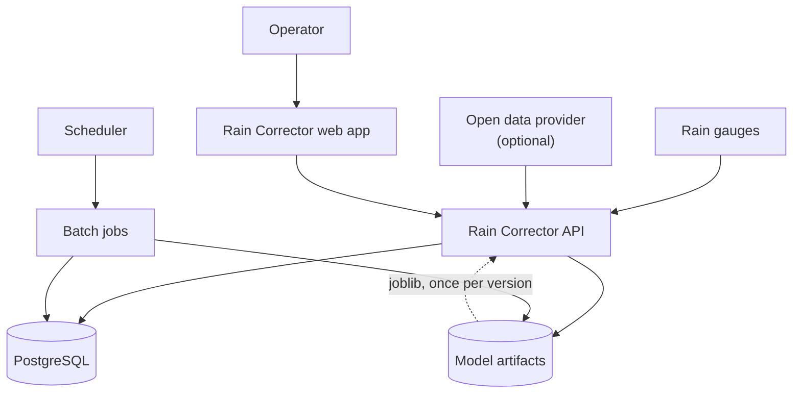
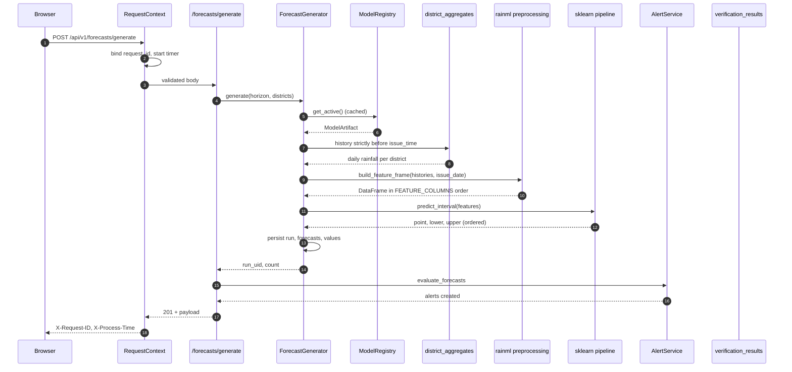
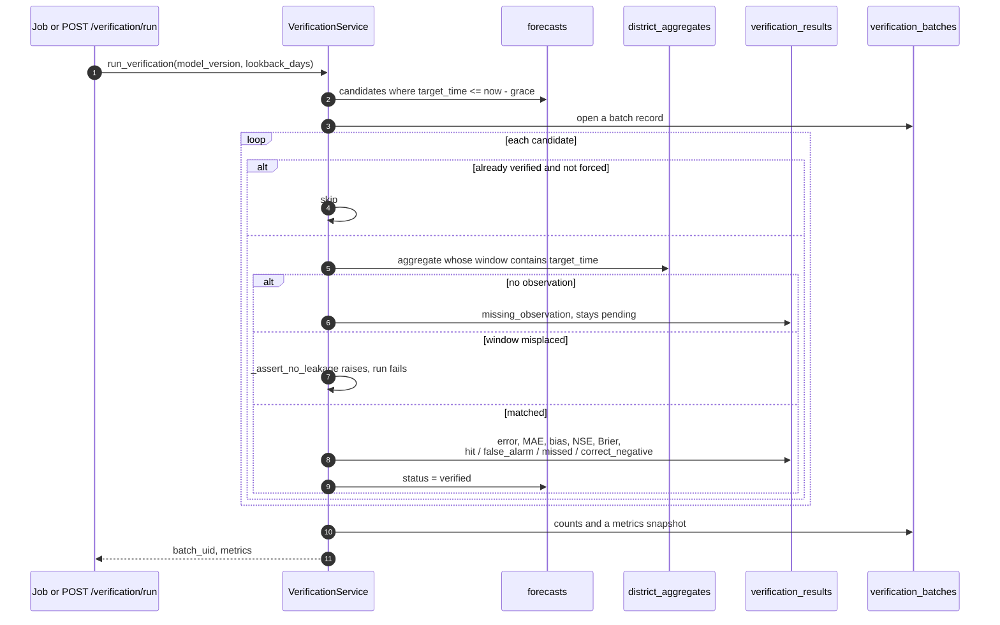
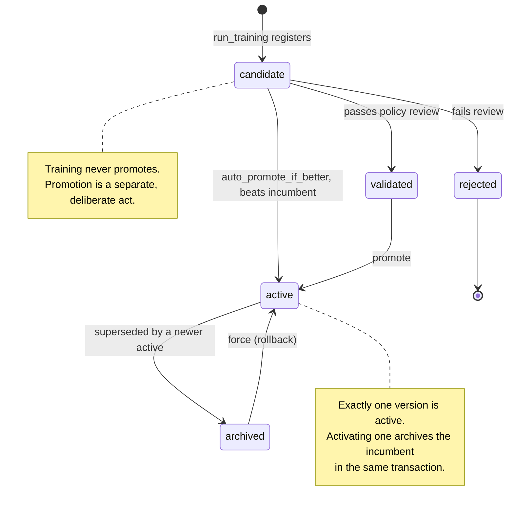
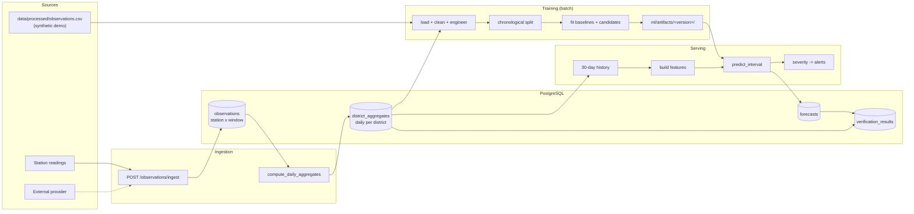
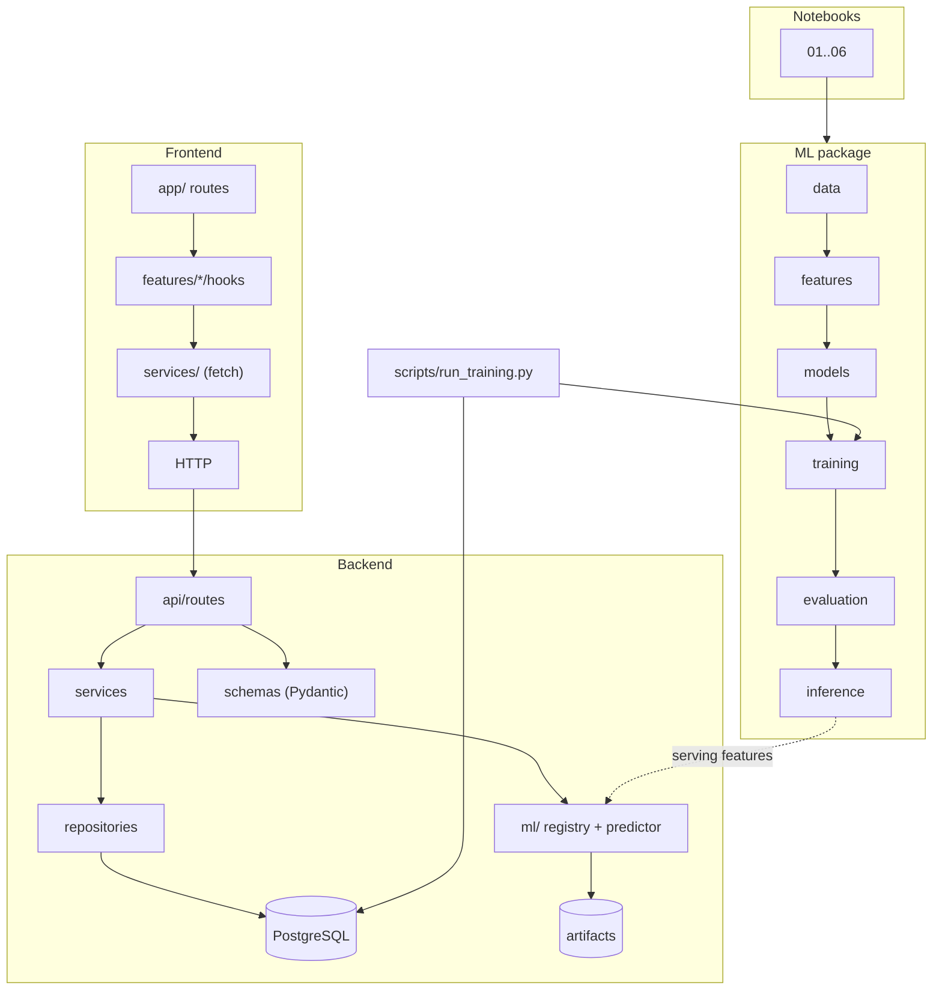
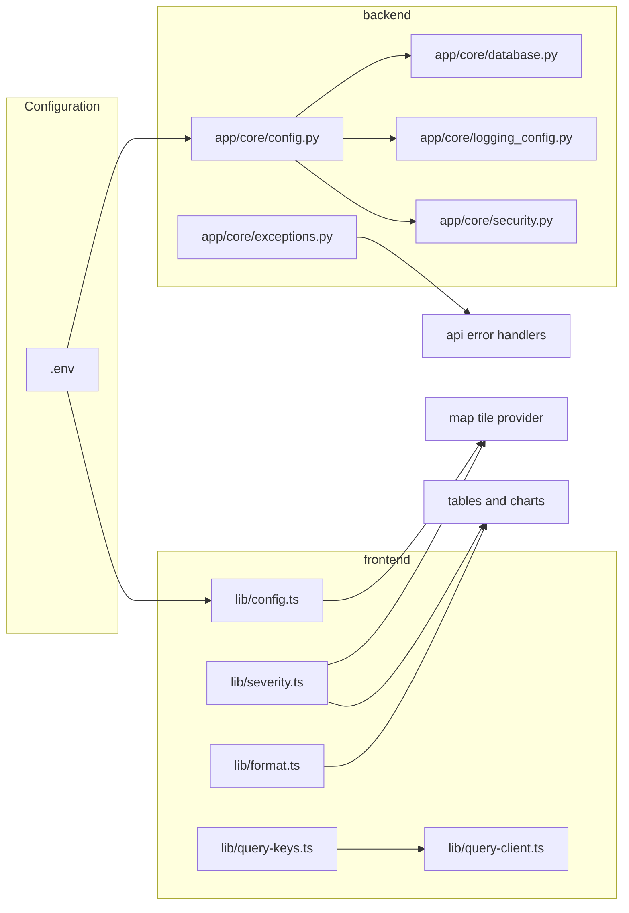

# Diagrams

Source diagrams live in [ARCHITECTURE.md](../../ARCHITECTURE.md), rendered with
Mermaid. This file collects the ones worth reading on their own, plus the
data-flow views that are easier to reason about as a picture than as prose.

## 1. System context

The operator, the gauges, the scheduler and the database are outside the
boundary. The API is the only component that serves user traffic.

## 2. Request and inference path

## 3. Verification path

Two invariants in that loop are load-bearing: an unmatched observation leaves the
forecast pending rather than scoring it as zero, and a misplaced window raises
rather than scoring the wrong period.

## 4. Retraining and promotion

## 5. Data flow

`district_aggregates` is the single junction: it feeds both the training dataset
and the verification ground truth, so the two cannot disagree about what a
district's rainfall was.

## 6. Layering

Arrows point in the allowed direction only. There is no path from the frontend
to the database or to a model, and no path from `rainml` back into the backend.

## 7. Component ownership

One configuration source per runtime. The severity tokens are defined once on the
server (`app/services/severity.py`, served at `/forecasts/legend`) and mirrored
for display in the client, so a band change propagates rather than drifting.
